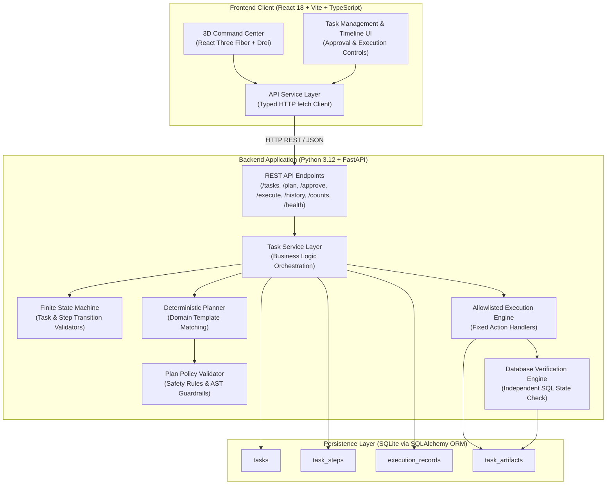

# CEREVIORA

**AI-Powered Personal Intelligence & Task Automation Platform**

[](https://github.com/KamleshJayasankar/cereviora/actions/workflows/ci.yml)
[](https://www.python.org/)
[](https://fastapi.tiangolo.com/)
[](https://react.dev/)
[](https://www.typescriptlang.org/)
[](https://threejs.org/)
[](https://github.com/KamleshJayasankar/cereviora)

CEREVIORA is a full-stack personal intelligence and task automation platform designed for reliable, auditable, and human-guided execution. It transforms high-level requests into structured execution plans, enforces human-in-the-loop approval gates, executes only safe allowlisted operations, independently verifies database state, and records a permanent audit history.

The platform pairs a responsive REST API backend and finite state machine with a 3D Command Center built in React Three Fiber, delivering deep system observability across desktop and mobile devices.

---

## Table of Contents

- [Problem Statement & Goals](#problem-statement--goals)
- [System Architecture](#system-architecture)
- [The Six-Stage Workflow](#the-six-stage-workflow)
- [Core Features](#core-features)
- [Technology Stack](#technology-stack)
- [Security & Reliability Design](#security--reliability-design)
- [API Reference](#api-reference)
- [Screenshots & Visuals](#screenshots--visuals)
- [Installation & Setup (macOS)](#installation--setup-macos)
- [Configuration & Environment Variables](#configuration--environment-variables)
- [Automated Testing & Verification](#automated-testing--verification)
- [Current Limitations & Roadmap](#current-limitations--roadmap)

---

## Problem Statement & Goals

### The Problem
Modern agentic AI and task automation tools frequently suffer from two critical flaws:
1. **The "Black Box" Execution Hazard**: Many autonomous agents run untrusted model outputs through unconstrained shell environments (`eval()`, arbitrary bash scripts), risking command injection, data corruption, and catastrophic side effects.
2. **Superficial CRUD Prototypes**: Many portfolio projects lack true state lifecycle validation, independent output verification, durable audit logging, and resilient error recovery.

### The Goals
CEREVIORA solves these challenges with architectural rigor:
- **Zero-Trust Execution**: No arbitrary code execution. Plans dispatch exclusively through a strict allowlist of deterministic operations (`interpret`, `research`, `generate`, `extract`, `save`, `verify`).
- **Human-in-the-Loop Gate**: Every plan requires explicit human approval before running. If a user modifies the task description or title after approval, the system immediately invalidates the signature and requires re-approval.
- **Independent State Verification**: Execution success is never assumed from function completion. A dedicated verification engine queries the SQLite database directly to confirm persisted artifacts and step state integrity.
- **Immutable Audit Trail**: All approval events, execution attempts, output summaries, verification receipts, and failure traces are persisted in SQLite.
- **Zero-Cost Local Portability**: The entire core platform runs locally with zero external API dependencies, zero paid keys, and a lightweight deterministic planner.

---

## System Architecture

CEREVIORA is structured into three clean, decoupled tiers:



### Architectural Decisions
- **Separation of Concerns**: FastAPI route handlers are thin controllers that validate incoming Pydantic payloads and delegate to `app/services/task_service.py`. Business logic has zero knowledge of HTTP request/response objects.
- **Dependency Injection**: Database sessions (`db: Session = Depends(get_db)`) are injected per request and guaranteed to close cleanly upon completion or exception.
- **SQLite with SQLAlchemy ORM**: Zero-configuration, file-based persistence for local portability. Database models can switch to PostgreSQL simply by updating `DATABASE_URL`.

---

## The Six-Stage Workflow

CEREVIORA maps user intent into a structured 6-stage lifecycle, visible in both the 3D Command Center and the execution pipeline:

| Stage | Identifier | Icon | Purpose & Operational Logic |
| :--- | :--- | :---: | :--- |
| **1. Interpret** | `interpret` | `◎` | Ingests the task title and optional description, cleans whitespace, and extracts structured intent. |
| **2. Plan** | `plan` | `◈` | The deterministic planner generates 5–6 ordered, contiguous steps matching task domain templates (`study`, `research`, `development`, `general`). Policy validator verifies safety rules; task enters `AWAITING_APPROVAL`. |
| **3. Approve** | `approve` | `◉` | Protected human gate. Requires explicit review. Sets `approved_at` timestamp and writes an `APPROVAL` record into the audit trail. Any subsequent task edit resets approval. |
| **4. Execute** | `execute` | `▶` | Transitions task to `RUNNING`. Dispatches steps sequentially through allowlisted handlers. Step attempts, timestamps, and outputs are logged in real time. |
| **5. Verify** | `verify` | `✓` | Performs an independent database query checking that the output artifact exists in `task_artifacts` and all prior steps completed in `SUCCEEDED` state. |
| **6. Store** | `store` | `⊞` | Persists execution results, step completion timestamps, and full audit logs to SQLite. Transitions task status to `SUCCEEDED`. |

---

## Core Features

- **Full Task CRUD**:
  - Create tasks with title and detailed description.
  - Paginated list retrieval with status filters (`PENDING`, `AWAITING_APPROVAL`, `RUNNING`, `SUCCEEDED`, `FAILED`).
  - Partial updates via `PATCH` with auto-invalidation of prior approvals.
  - Cascading deletion removing child steps, execution records, and artifacts.
- **Deterministic Planning & Safety Validation**:
  - Produces structured execution pipelines without relying on external model APIs.
  - Safety validator guarantees contiguous step ordering, step limits (maximum 10), allowlisted types, and keyword rejection (blocks `eval(`, `os.system`, `subprocess`, `rm -rf`, `DROP TABLE`).
- **Finite State Machine Enforcement**:
  - Formal transition tables prevent illegal state jumps (e.g., jumping from `PENDING` directly to `RUNNING` or `SUCCEEDED`).
  - Graceful failure recovery: `FAILED` tasks safely transition back to `PENDING` upon replanning.
- **Persistent Execution & Approval Audit**:
  - `ExecutionRecord` table stores event types (`APPROVAL`, `STEP`), attempt counts, inputs, outputs, error details, verification flags, and UTC timestamps.
  - Audit history queryable via REST API and displayed on both Dashboard and Task views.
- **Interactive 3D Command Center (React Three Fiber)**:
  - Central rotating "Intelligence Core" with procedural icosahedron geometry, wireframe glow, and orbital rings.
  - 6 interactive workflow orbs with Catmull-Rom spline connectors, live status colors, and HTML labels.
  - Responsive camera framing: dynamically adjusts camera distance ($z \approx 9.2 \to 12.5$) based on viewport aspect ratio, ensuring all 6 nodes remain fully visible at 375px mobile viewports without horizontal clipping.
  - WebGL feature detection with graceful 2D fallback.
  - Supports `prefers-reduced-motion` accessibility settings.
- **Mobile-First Responsive Layout**:
  - Tested across 375×812 (iPhone SE/mobile) and 1440px desktop viewports with 0 horizontal overflow.

---

## Technology Stack

### Backend
- **Python 3.12**: Modern Python runtime with strong typing.
- **FastAPI 0.115**: High-performance asynchronous API framework with automatic OpenAPI documentation.
- **Pydantic v2 (2.10)**: Strict request/response parsing and input validation.
- **SQLAlchemy 2.0**: Python SQL toolkit and Object-Relational Mapper.
- **SQLite 3**: Embedded transactional database engine.
- **Uvicorn 0.32**: ASGI web server implementation.
- **pytest 8.3 & HTTPX**: Testing suite with in-memory SQLite isolation.

### Frontend
- **React 18.3**: UI library with functional components and hooks.
- **TypeScript 5.6**: Static type-checking across components, API services, and domain types.
- **Vite 5.4**: Fast frontend build tool and development server.
- **Three.js (r170)**: 3D computer graphics library.
- **React Three Fiber (R3F 8.17)**: Declarative Three.js wrapper for React.
- **React Three Drei 9.117**: Reusable 3D helpers (`Html`, `Stars`).
- **React Router DOM 6.28**: Declarative client-side routing.
- **Vanilla CSS with Custom Properties**: Glassmorphism aesthetic, dark mode theme, CSS grid and flexbox.

---

## Security & Reliability Design

| Security Measure | Implementation | Impact |
| :--- | :--- | :--- |
| **Approval Gate** | `POST /tasks/{id}/approve` | Tasks cannot run without human sign-off; requests fail with `403 Forbidden`. |
| **Approval Invalidation** | `app/services/task_service.py` | Modifying task title or description automatically resets `approved_at = None`. |
| **Allowlisted Execution** | `app/services/execution_engine.py` | Dispatches only explicit handlers (`interpret`, `research`, `generate`, `extract`, `save`, `verify`). No `eval`, `exec`, or shell calls. |
| **Closed Failure Policy** | `ExecutionPolicyError` | Unknown or disallowed step types fail closed immediately. |
| **Real DB Verification** | `execute_step()` -> `verify` | Directly queries SQLite `task_artifacts` and step records rather than trusting in-memory state. |
| **Input Sanitization** | `TaskCreate` & `TaskUpdate` | Title whitespace trimmed; blank strings rejected (`422 Unprocessable Entity`); length capped at 200 chars. |
| **Error Contract** | FastAPI Exception Handlers | Uniform `{ "detail": "..." }` error envelopes handled by frontend API service. |

---

## API Reference

The interactive Swagger UI is accessible at `http://localhost:8000/docs` and ReDoc at `http://localhost:8000/redoc`.

### Health & System
| Method | Endpoint | Description | Status Codes |
| :--- | :--- | :--- | :--- |
| `GET` | `/health` | Service health status, database connection, and app version | `200` |
| `GET` | `/` | API welcome banner and link to `/docs` | `200` |

### Task Management
| Method | Endpoint | Request Body | Description | Status Codes |
| :--- | :--- | :--- | :--- | :--- |
| `POST` | `/tasks` | `{ "title": "...", "description": "..." }` | Create a new task in `PENDING` state | `201`, `422` |
| `GET` | `/tasks` | Query: `status`, `limit` (100), `offset` (0) | List tasks (newest first) with total count | `200`, `422` |
| `GET` | `/tasks/counts` | None | Aggregated status counts for dashboard stats | `200` |
| `GET` | `/tasks/{id}` | None | Get full task details including child steps | `200`, `404` |
| `PATCH` | `/tasks/{id}` | `{ "title"?: "...", "description"?: "..." }` | Partial update; invalidates prior approval | `200`, `404`, `422` |
| `DELETE` | `/tasks/{id}` | None | Permanently delete task and cascade child records | `200`, `404` |

### Planning & Execution Lifecycle
| Method | Endpoint | Request Body | Description | Status Codes |
| :--- | :--- | :--- | :--- | :--- |
| `POST` | `/tasks/{id}/plan` | Optional `{ "custom_instructions": "..." }` | Generate validated execution steps; status `AWAITING_APPROVAL` | `200`, `400`, `404`, `422` |
| `POST` | `/tasks/{id}/approve`| None | Record human approval for plan; sets `approved_at` | `200`, `400`, `404`, `409` |
| `POST` | `/tasks/{id}/execute`| None | Execute approved plan through allowlisted engine | `200`, `400`, `403`, `404` |
| `GET` | `/tasks/{id}/history`| None | Retrieve persistent approval and execution audit log | `200`, `404` |

---

## Screenshots & Visuals

> *Note: Place your screenshot images in `docs/screenshots/` to display them here.*

| View | Preview Placeholder | Description |
| :--- | :--- | :--- |
| **3D Command Center** | `docs/screenshots/dashboard-desktop.png` | Interactive WebGL workflow scene with live task metrics and node selection. |
| **Mobile Responsiveness** | `docs/screenshots/dashboard-mobile.png` | Optimized 375px mobile view with 2-column workflow selectors and zero overflow. |
| **Execution Plan Timeline** | `docs/screenshots/tasks-plan.png` | Policy-validated step pipeline with status indicators and approval controls. |
| **Audit Trail** | `docs/screenshots/audit-history.png` | Chronological audit log with database verification confirmations and error traces. |

---

## Installation & Setup (macOS)

### Prerequisites
- **Python**: Version 3.12 or higher (`python3 --version`)
- **Node.js**: Version 18.x or higher (`node --version`)
- **Git**: Installed (`git --version`)

### 1. Clone the Repository
```bash
git clone https://github.com/KamleshJayasankar/cereviora.git
cd cereviora
```

### 2. Backend Setup
Open a terminal for the backend:

```bash
# Navigate to backend directory
cd backend

# Create and activate Python virtual environment
python3 -m venv .venv
source .venv/bin/activate

# Install required dependencies
pip install -r requirements.txt

# Start the FastAPI server with auto-reload
python -m uvicorn app.main:app --host 0.0.0.0 --port 8000 --reload
```

The backend API will start at:
- **API Base URL**: `http://localhost:8000`
- **Swagger Documentation**: `http://localhost:8000/docs`
- **Health Check**: `http://localhost:8000/health`

### 3. Frontend Setup
Open a second terminal for the frontend:

```bash
# Navigate to frontend directory
cd frontend

# Install npm dependencies
npm install

# Start the Vite development server
npm run dev
```

The frontend web application will start at:
- **Local Application URL**: `http://localhost:5173`
- (Vite dev proxy forwards `/api/*` requests directly to `http://localhost:8000`)

---

## Configuration & Environment Variables

All configuration is centralized and strongly typed via Pydantic BaseSettings.

### Backend (`backend/.env` optional)
| Variable | Default Value | Description |
| :--- | :--- | :--- |
| `DATABASE_URL` | `sqlite:///./cereviora.db` | SQLAlchemy connection string. Defaults to local SQLite database. |
| `CORS_ORIGINS` | `["http://localhost:5173", "http://localhost:3000"]` | Allowed CORS origins for browser fetch requests. |
| `APP_NAME` | `CEREVIORA` | Application title reported in metadata and docs. |
| `APP_VERSION` | `0.1.0` | Semantic version string. |
| `DEBUG` | `false` | Enables SQL query echo logging in SQLAlchemy when set to `true`. |

### Frontend (`frontend/.env` optional)
| Variable | Default Value | Description |
| :--- | :--- | :--- |
| `VITE_API_BASE_URL` | `/api` | Base path for API requests. In development, Vite proxies `/api` to `http://localhost:8000`. |

---

## Automated Testing & Verification

CEREVIORA includes an automated test suite verifying all database operations, state machine transitions, planner policies, execution safety, and end-to-end integration.

### Run Backend Tests
Tests run against an isolated in-memory SQLite database via SQLAlchemy's `StaticPool`:

```bash
cd backend
python -m pytest tests/ -v
```

**Verified Test Results (78 / 78 Passing)**:
- `tests/test_health.py` (3 passed): Health check endpoints and shape verification.
- `tests/test_tasks.py` (35 passed): CRUD operations, Pydantic validation, title trimming, 404s, pagination, status counts, and persistence.
- `tests/test_state_machine.py` (12 passed): Lifecycle state transitions, failure resets, replanning cancellation, illegal jump rejections.
- `tests/test_planner.py` (10 passed): Domain template planning (`study`, `research`, `development`, `general`), step ordering, and policy rules.
- `tests/test_task_planning.py` (6 passed): Plan generation endpoint, persistence, replan step clearing, and cascade deletion.
- `tests/test_execution.py` (5 passed): Approval enforcement, allowlisted execution, simulated failure auditing, and verification checks.
- `tests/test_reliability_e2e.py` (7 passed): End-to-end lifecycle verification, direct SQLite table inspection, retry deduplication, and edit invalidation.

```text
============================== 78 passed in 1.68s ==============================
```

### Run Frontend Lint & Build Checks
```bash
cd frontend

# Run ESLint (TypeScript + React rules)
npm run lint
# Output: Passed with 0 warnings, 0 errors

# Run TypeScript type check and production bundle build
npm run build
# Output: Succeeded (0 TypeScript errors)
# Note: Vite emits a bundle chunk-size warning for WorkflowScene
# (833.80 kB before gzip / 225.04 kB gzip), isolated into its own lazy-loaded dynamic chunk.
```

---

## Current Limitations & Roadmap

### Current Limitations
- **Local Single-User Architecture**: Designed for local development and portfolio demonstration; multi-user authorization and authentication (JWT/OAuth) are not yet integrated.
- **Hard Deletion**: Deleting a task performs a hard delete cascading to related steps and execution records rather than soft deletion (`deleted_at`).
- **Pluggable Planner Interface**: The current implementation uses the deterministic planner for zero-cost reproducibility; LLM provider bindings (e.g. Ollama or cloud models) are architected as drop-in replacements.
- **3D WorkflowScene Bundle Size**: The 3D visualization component (`WorkflowScene`) compiles to 833.80 kB (225.04 kB gzipped) due to Three.js and Drei dependencies, triggering Vite's default 500 kB chunk-size warning. While it is code-split via `React.lazy()` so the initial dashboard load remains lightweight (189.05 kB / 60.83 kB gzipped), manual chunk splitting or dynamic sub-module imports are a known optimization item.

### Roadmap
- [ ] **Optional Local AI Provider**: Integrate local Ollama instances (`llama3`, `mistral`) through the existing `Planner` abstraction.
- [ ] **PostgreSQL Production Configuration**: Provide Docker Compose setup for PostgreSQL and containerized services.
- [ ] **WebSocket Telemetry**: Stream real-time step execution events to the 3D Command Center.
- [ ] **Soft Deletion & Recovery**: Add soft deletion flags to maintain historical audit logs even after task removal.
